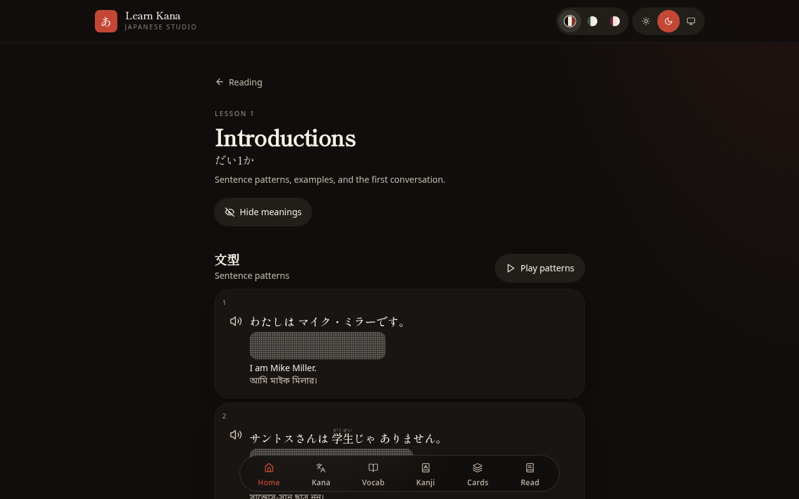

# Learn Kana (learnjp)

**Learn Japanese from the first stroke** — hiragana, katakana, kanji, vocabulary, grammar and reading lessons following _Minna no Nihongo_, with English and Bangla beside every line and native-voice audio.

[](https://github.com/pixel404dot/learnjp/actions/workflows/ci.yml)
[](https://github.com/pixel404dot/learnjp/actions/workflows/pages.yml)
[](LICENSE)

**▶ Try it live: <https://pixel404dot.github.io/learnjp/>** (static demo, progress is saved in your browser)

Full version with sign-in and cloud sync: <https://learnjp.grok.me>


## Features

- **Kana drills** — pick hiragana or katakana rows (gojūon, dakuten, combos) and drill them with timed, counted or unlimited sessions, touch mode, word practice, handwritten-style fonts, auto-next and no-repeat options.
- **Vocabulary** — 25 lessons with kana, meaning and listening quizzes, a shuffle mode and spaced-repetition (SRS) review of due words.
- **Kanji** — 124 single kanji and 59 kanji words.
- **Grammar** — 118 JLPT N5 grammar points grouped into 12 phases, with narrated explanations.
- **Reading** — lessons 1–20 with sentence patterns, example sentences and conversations (会話), furigana, hide-meanings mode and read-aloud.
- **Cards** — make your own lesson or kanji decks and review them Anki-style (Again / Hard / Good / Easy).
- **Progress** — per-character and per-word stats and an overall “known words” score.
- **English + Bangla** translations, with pre-generated Japanese (female and male voices) and Bangla audio.
- Light / dark / system themes and several colour palettes.
- Optional sign-in (Google or X) that syncs progress across devices on the full deployment.
- Android app wrapper built with Capacitor.



## Tech stack

- [React 19](https://react.dev) + [TanStack Start / Router](https://tanstack.com/start) on [Vite](https://vite.dev)
- [Tailwind CSS v4](https://tailwindcss.com), Radix UI primitives, lucide icons
- [Zustand](https://zustand.docs.pmnd.rs) for local state (persisted to `localStorage`)
- [Better Auth](https://www.better-auth.com) + Postgres via [Kysely](https://kysely.dev)/`pg` (embedded [PGLite](https://pglite.dev) locally) for optional accounts and progress sync
- [Nitro](https://nitro.build) (Vercel preset) for the server build
- [Capacitor](https://capacitorjs.com) for Android
- Python scripts (edge-tts, xAI TTS) to pre-generate the audio files

## Getting started

### Prerequisites

- Node.js **22** and npm

### Install and run

```bash
git clone https://github.com/pixel404dot/learnjp.git
cd learnjp
npm ci
npm run dev          # http://localhost:8080
```

No configuration is needed for local development: without `DATABASE_URL` the app uses an embedded PGLite database and applies `migrations/` automatically.

### Environment variables

All are optional — see [`.env.example`](.env.example).

| Variable                                                             | Purpose                                                                                       |
| -------------------------------------------------------------------- | --------------------------------------------------------------------------------------------- |
| `DATABASE_URL`                                                       | Postgres connection string for production (e.g. Neon). Migrations run during `npm run build`. |
| `VITE_AUTH_ENABLED`                                                  | Set to `false` to disable sign-in; progress then stays in the browser.                        |
| `BETTER_AUTH_SECRET`, `BETTER_AUTH_URL`                              | Session secret and public URL for sign-in in production.                                      |
| `GROK_AUTH_ISSUER`, `GROK_AUTH_CLIENT_ID`, `GROK_AUTH_CLIENT_SECRET` | OAuth client for the sign-in broker (Google / X).                                             |
| `VITE_STATIC_SITE`, `BASE_PATH`                                      | Static (GitHub Pages) build — see below.                                                      |

### Scripts

| Command                | What it does                                                           |
| ---------------------- | ---------------------------------------------------------------------- |
| `npm run dev`          | Start the dev server on port 8080                                      |
| `npm run build`        | Production build (Vercel output in `.vercel/output`) and DB migrations |
| `npm run build:static` | Client-only build in `dist/client` (use with `VITE_STATIC_SITE=true`)  |
| `npm run preview`      | Preview the production build                                           |
| `npm run lint`         | ESLint                                                                 |
| `npm run typecheck`    | TypeScript type check                                                  |
| `npm test`             | Node test runner suites                                                |
| `npm run format`       | Prettier                                                               |

### Static build (GitHub Pages)

The live demo is deployed by [`.github/workflows/pages.yml`](.github/workflows/pages.yml) on every push to `main`. To build it yourself:

```bash
VITE_STATIC_SITE=true VITE_AUTH_ENABLED=false BASE_PATH=/learnjp/ npm run build:static
cp dist/client/index.html dist/client/404.html   # SPA fallback for deep links
```

The static build has no server, so **sign-in and cross-device progress sync are not available** there; everything else (all lessons, drills, audio, decks and progress) works and is stored in your browser’s `localStorage`.

## Project structure

```
src/
  routes/        Pages (file-based routing): kana, vocabulary, kanji, grammar, reading, cards, progress
  components/    UI components (lesson catalog, practice session, card editor, …)
  lib/           Lesson data (vocab, kanji, grammar, reading), SRS, speech/audio, store, auth, DB
public/audio/    Pre-generated mp3 audio and grammar narration
migrations/      SQL migrations (auth tables, user progress, decks)
server/          Nitro server middleware
scripts/         Build helpers, migration runner, tests and audio-generation scripts
android/         Capacitor Android project
mobile-www/      Placeholder web dir for the Capacitor app
```

## Android

The Android app is a Capacitor wrapper that loads the hosted site (`server.url` in [`capacitor.config.ts`](capacitor.config.ts)).

```bash
npx cap sync android
cd android && ./gradlew assembleDebug
```

For a signed release build, copy `android/keystore.properties.example` to `android/keystore.properties` and point it at your own keystore (both are git-ignored), then run `./gradlew assembleRelease`.

## Audio generation

Audio in `public/audio/` is pre-generated and committed, so you don't need these scripts to run the app. They are one-off helpers:

- `scripts/gen-ja-audio.py`, `scripts/gen-ja-male-audio.py`, `scripts/gen-bn-audio.py` — Japanese (female/male) and Bangla clips via Microsoft neural voices with [`edge-tts`](https://github.com/rany2/edge-tts) (`pip install edge-tts`). They read a JSON list of phrases from `/tmp/ja-audio.json` or `/tmp/bn-audio.json` and update the matching `src/lib/audio-*.ts` map.
- `scripts/gen-grammar-voice.py` — grammar narration via the xAI text-to-speech API (needs `XAI_API_KEY`).

## Contributing

Contributions are welcome — see [CONTRIBUTING.md](CONTRIBUTING.md).

## License

[MIT](LICENSE) © 2026 pixel404dot
